# National dilemma game: asynchronous participation — IA v3

Status: PROPOSED after two critiques; not agreed or implemented
Date: 2026-11-09
Supersedes: IA v2 in this file; no existing app behaviour is changed

Confirmed by Tal: `C_p` is the consensus metric; RPE means reward prediction error; Sign is the existing `apps/sign` application. The low-involvement participant must have a complete view → evaluate → final-vote path without authoring. Dan's creator/explorer path and the shared dilemma-level needs/questions are retained. The resolution contract below is a proposed improvement, not user signoff.

Purpose: citizens develop solutions to national dilemmas while others contribute through informed evaluation and final voting. Publication/revision and successful short evaluation/voting visits are both valid outcomes. People choose their involvement; conversion to authors is not a goal for everyone.

Sources and method:
- Tal's Functional Flow: `/Users/talyaron/Desktop/Screenshot 2026-11-09 at 14.27.45.png`; User Journey and Hooks chapters of [Tal's book](https://docs.google.com/document/d/1EMvQLxr6SeLVF6mqoelnPgsOw8dRYuX0NWSxssS-x7Q/edit#heading=h.t19yez1z5her).
- Supplied critiques: `/Users/talyaron/.codex/attachments/26b57a10-1193-4652-99f4-4fe1d03f9956/Pasted text.txt` and `/Users/talyaron/.codex/attachments/0b23f310-03b3-47a0-b6f5-c4b924b2cf0a/Pasted text.txt`.
- Existing context: `apps/join-class/src/lib/lessonCore.ts`, `views/student/StudentStage.ts`, `docs/ia/join-class-lesson-plan.md`; MC `SurveyNavigation.tsx` and `app/s/[surveyId]/q/[index]/page.tsx`; shared Statement and consensus models.
- Sign capability evidence: `apps/sign/src/components/document/SatisfactionScale.tsx`, `SatisfactionFeedbackModal.tsx`, `DocumentClient.tsx`; `apps/sign/app/api/signatures/[docId]/route.ts`; `apps/sign/src/lib/firebase/reportQueries.ts`.
- Hooks are design hypotheses: need → trigger → useful action → experienced reward; investment supplies future useful content. Neither the critique's 90–9–1 distribution, guaranteed retention, nor a 2–4-hour dopamine deadline is an established premise here. RPE is not measured by drawing a reward symbol.

## 1. Audiences

| Audience | One-line goal | Must never see |
|---|---|---|
| Dan: opinionated, curious creator/explorer | Express and improve a solution; discover what his contribution changed | Another person's private draft or an invented endorsement |
| Low-involvement participant | Make an informed choice with little time | A requirement to write, add needs, answer questions or rate everything |
| Convener / moderator | Frame fairly, allocate real review capacity and publish an accountable outcome | Private drafts through ordinary moderation views |
| Public reader | Understand solutions, disagreements and what happens next | Claims that this self-selected participation represents the nation |

The two participation paths are flexible preferences, not permission roles or levels. They share one participant home. Someone may switch paths or finish a short visit without becoming Dan. A useful 3–5-minute visit is a timing hypothesis to test.

## 2. Object model

| Object | Relations and lifecycle | Mapping / constraint |
|---|---|---|
| Series | One series → many editions | Top-level group Statement |
| Dilemma | One edition: prepared → developing → reassessing → final vote → published | Question Statement under series; proposed edition settings |
| Brief | Versioned scope, constraints, sources and competing concerns | Paragraph children of dilemma |
| Solution | Stable identity and author; private draft → published version → revised version | Published option Statement; private drafts require owner-only storage |
| Solution version | Immutable assessed text; many per solution | Version record/snapshot; shared schema and write rules need validation |
| Need | Shared concern relevant to many solutions | Dilemma-level child Statement with need semantics |
| Exploration question / answer | Dilemma → questions → answers | Question Statement and answer children; distinct from solutions |
| Feedback | A question, concern or improvement about a solution version | Child Statement linked to that version |
| Review task | Offered → completed/skipped/expired | Assignment metadata, not a table or permanent group |
| Development evaluation | One participant's rating of a developing version | Version-bound evaluation; computes provisional `C_p` |
| Final candidate | At most 3 separately authored frozen versions in the pilot | Stable candidate ID links original solution, author, version and final Sign document |
| Final evaluation | One saved rating per eligible participant/candidate/phase/version | Fresh five-point evaluation; sole input to that candidate's final `C_p` |
| Outcome | Final scores, coverage, concerns, qualification and next action | Report referencing candidate versions; does not replace authors' solutions |

Tree: series group → dilemma question → solution option → feedback. Brief paragraphs, needs and exploration questions are siblings under the dilemma; answers belong under their question. Use `createStatementObject`, preserving `parentId`, `parents`, `topParentId`. Snapshot, candidate, phase and evaluation bindings require a proposed adapter; they are not assumed to exist.

**Revision contract.** Keep the solution's stable card, author, URL and history. Show “V1: historical `C_p`, n; V2: awaiting re-assessment” until V2 has ratings. Historical ratings never count as current and are not used silently for nomination. Pending means unassessed, not zero support or a bottom-ranked failure. Invite all prior raters, including dissenters, to inspect the change summary/full text and reaffirm or change their rating; no automatic transfer. Preserve discovery visibility through bounded new-review allocation, with a published revision budget so repeated edits cannot buy endless boosts.

**Pilot publication budget.** One active solution eligible for nomination per author, with at most 3 published content versions: V1 plus 2 revisions. Private drafts are unlimited. Clones/replacements preserve lineage and do not reset the author's edition budget. Every edit to assessed wording creates a new version; display-only formatting may be a presentation change. There is no self-declared “minor edit” that inherits ratings. The end-of-Day-8 cutoff applies uniformly to new solutions and revisions; no earlier newcomer cutoff or last-day requirement to already have feedback.

**One ending.** Development evaluations guide improvement and nomination. One final vote is delivered through Sign on the frozen candidates, using `[-1, -0.5, 0, 0.5, 1]` to answer the same agreement question for each whole solution. The adapter calls this agreement, not satisfaction. Fresh final evaluations produce final `C_p`, the sole final ranking metric. There is no separate majority winner, mandatory signature or clause-by-clause ratification. Clause detail/evaluation can remain optional and never substitutes for the whole-solution final rating.
Scale meaning: `0` neutral, `+0.5` somewhat agree, `+1` strongly agree; negative values express the corresponding disagreement. The interval `[0, +0.5]` is neutral to somewhat agree, not somewhat to strongly agree.

## 3. Labels

All keys and game routes are hypothetical. Existing apps retain their labels until implementation is approved. “Proposal” may remain an internal schema word; this game's citizen-facing object is consistently “solution”.

| Concept | EN label | HE label | Proposed key | Route / code mapping | Avoid |
|---|---|---|---|---|---|
| Dilemma | Dilemma | דילמה | `dilemma.title` | `d`; question Statement | שיעור / סקר |
| Brief | Background | רקע | `dilemma.background` | `background`; paragraphs | Mandatory lengthy onboarding |
| Solution | Solution | פתרון | `solution.title` | `solutions`; option Statement | תשובה / הצעה as competing UI labels |
| Private draft | My draft | הטיוטה שלי | `solution.draft` | `mine`; owner-only draft | Public solution |
| Shared need | Need | צורך | `need.title` | `needs`; dilemma child | Feedback-only home |
| Shared question | Question | שאלה | `question.title` | `questions`; question Statement | Required authoring step |
| Question response | Answer | תשובה | `answer.title` | within question | פתרון for every answer |
| Response to solution | Feedback | משוב | `feedback.title` | within solution/version | Endless chat |
| Rating action | Rate agreement | דירוג הסכמה | `evaluation.agreement` | phase/version-bound evaluation | A signature / a percentage of supporters |
| Score | Consensus | הסכמה | `solution.consensus` | `C_p` plus n and version | Likes / cross-group proxy |
| Final candidate | Candidate solution | פתרון מועמד | `candidate.title` | frozen solution version | Winner before final vote |
| Final phase | Final vote | הצבעה מסכמת | `vote.final` | game entry → Sign adapter | Separate majority vote / compulsory signing |
| Result | What emerged | מה גיבשנו | `outcome.title` | `outcome`; report | החלטת הציבור |

## 4. Hierarchy (per role)

Hypothetical game namespace `/play`; choice of hosting app remains open.

```text
Participant / public reader
0 Dilemmas /play
1   Dilemma /play/d/:id
2     Background /background
2     My solution /mine
2     Solutions /solutions
3       Solution /solutions/:solutionId?version=:versionId
2     Help improve /review
2     Needs /needs (view/add)
2     Questions /questions
3       Question /questions/:questionId (view/answer)
2     Final vote /final (handoff/resume, not a second ballot)
3       Continuous Sign candidate flow (one session, separate snapshots)
2     What emerged /outcome
Convener / moderator
0 Dilemmas /play/manage
1   Dilemma /play/manage/d/:id
2     Brief, schedule and published rules /setup
2     Review allocation and moderation /review
2     Frozen candidates /candidates
2     Outcome and follow-up /outcome
```

## 5. Navigation model

- The dilemma home shows context, a useful next action and explicit stopping points. Write a solution and view/evaluate solutions are independent entry paths; neither unlocks the other.
- Exploration branches to others' needs → add own need, and others' questions → answer. All can return to one's solution for improvement; needs/questions are shared across the dilemma.
- Offer a bounded batch of 2–3 real contributions, with skip and finish. No requirement to read/rate all solutions or all 3 final candidates. Missing ratings remain missing, never neutral or opposition.
- Finish is a genuine completed visit: saved confirmation, an optional truthful insight, optional share and optional final-vote reminder. No unfinished-creator checklist or forced daily return. During the final vote, confirm the individual's saved rating but hide aggregate final ratings, counts and rankings until closing; optional insights must not reveal live final results.
- Shared links open the canonical solution and named version directly. Essential dilemma context stays visible; the longer brief is collapsible. Links to historical versions identify them and offer the current version without silently switching the rated text.
- Back returns to the prior list/filter or dilemma. Feedback links restore the relevant solution version. Sign receives edition/candidate/version identity once and hosts a continuous candidate flow; no compulsory return to the game between candidates. Exact cross-app identity/URL mechanics remain implementation work.
- Rotate candidate order across participants and keep it stable for each person. Within Sign, next/back, skip, Done and later resume operate over independent snapshots and independently saved ratings. Confirm each successful save; preserve input and offer retry on failure rather than marking it rated. Do not advance past a failed save without an explicit choice. No obligatory written-feedback modal or page reload between candidates, and the same neutral save confirmation for every rating value. “Rated 1 of 3” is status, not an incomplete participation task.
- Proposed triggers: replies, daily digest, evaluation changes, re-assessment requests and final-vote opening. Offer separate preferences, bundling and unsubscribe; changes require an actual new event, not fabricated urgency.
- Late visitors can view/rate while the relevant phase is open; after closing, browse the outcome and save a private idea. Eligibility must be published, with no gate based on authoring or prior evaluation volume.

## 6. Task flows

Low-involvement participant — complete short visit (3 actions):
1. Dilemma — read the short context.
2. Solutions — inspect a few and rate agreement, or skip.
3. Finish — see saved confirmation; optionally share or request the final-vote reminder. This is a completed visit.

Low-involvement participant — final vote (3 actions):
1. Reminder or dilemma home — open the final candidate list and its fixed versions.
2. Sign — read/rate a whole solution; the save is confirmed before optional movement to the next candidate in the same flow. Inspect clauses, go back, skip, finish early or resume later; saved ratings remain editable while open.
3. Finish / outcome — receive confirmation and return to results when published. No prior writing, questions, needs, comments, signatures or full-candidate completion is required.

Low-involvement participant — share an insight (2 actions): Finish/outcome — inspect an insight about items actually rated, with version/count; optional share — send the canonical link and an editable neutral invitation. Sharing is not required to finish.

Dan — first useful visit (3 actions): invitation featuring dilemma → view dilemma; choose write or explore/evaluate; publish a solution into the shared pool or save privately. Optional private first sentence precedes others' ratings. Empty peer content is identified honestly; editorial seeds retain attribution.
Dan — explore and improve (3 actions): explore solutions/needs/questions → contribute if useful; own solution → incorporate or reject feedback with explanation; publish a new version with optional credit and preserved history.
Dan — re-assessment return (3 actions): real notification → inspect current version's feedback/`C_p`/n; compare changed text or others' solutions; reaffirm/change a rating. Before the content cutoff he may publish a revision within budget; after it, further ideas remain private for a later edition. Re-assessment requests go to all prior raters, not only supporters.

Convener — launch (3 actions): define scope, context, recipient and all §9 parameters; preview both participant paths and real review capacity; publish rules and open.
Convener — sustain (3 actions): inspect unanswered-work queue and latency; assign available reviewers or provide identified moderator feedback; handle reports/appeals and adjust recruitment to capacity.
Convener — close (3 actions): apply announced cutoff/coverage/nomination rules; open Sign final vote on at most 3 frozen candidates; publish final `C_p`, counts, concerns and next action without forcing a winner.
Public reader — understand (2 actions): outcome → candidate/version and evidence; inspect (2): search → solution history; participate (2): dilemma → evaluation or own draft. These do not define a mandatory progression.

## 7. Screen inventory

| Screen | Route / home | Single job | Key states |
|---|---|---|---|
| Dilemmas | `/play` | Find current edition/resume | No edition, loading, retry, archive |
| Dilemma | `/d/:id` | Context and optional next action | New/returning/late, current phase, unavailable |
| Background | `/background` | Inspect context/sources/rules | Loading, missing source, updated context |
| My solution | `/mine` | Draft, publish or revise | Private/saving/error/published; historical score/current pending; cutoff |
| Solutions / solution | `/solutions`, `/:solutionId` | Find and inspect versioned content | Empty/search/pagination/loading/error; current/historical/removed |
| Help improve | `/review` | Complete a bounded contribution | Available/skipped/done/expired; no content; no reviewer available |
| Needs | `/needs` | View/add shared concerns | Empty/loading/saving/error/saved/closed |
| Questions / question | `/questions`, `/:questionId` | Find and answer shared questions | No questions/answers, loading/error/saved/closed |
| Finish visit | current context | Confirm done; optional insight/share/reminder | Saved/error, insufficient data for insight, opted in/out |
| Final vote entry | `/final` | Review candidates and resume in Sign | Not open/open/closing/closed; no qualified shortlist |
| Continuous candidates in Sign | one adapter session | Rate independent fixed solutions without repeated app jumps | Per-candidate read/saving/rated/skipped/retry; stable order, early Done/resume; text locked/rating open or closed |
| What emerged | `/outcome` | Explain results and next action | Pending/insufficient evidence/no established consensus/published/follow-up |
| Manage edition | `/manage/d/:id/*` | Prepare, allocate, nominate and publish | Draft/open/cutoff/extension/final/closed; denied/error |

Every state retains a parent/return link; failed writes preserve input. No-feedback offers self-review or a completed exit. A recorded final rating counts as participation even when the person skips written feedback or other candidates.

## 8. Findability, scoring and scale

- With dozens, use one shared pool and an identified founding reviewer group. Permanent small tables fragment scarce activity. Editorial seed material is labelled; no synthetic citizens or fabricated activity.
- With thousands, use bounded queues: under-reviewed new solutions, current revisions and exploratory discovery. Separate offered exposure from completed evaluations. Publish allocation and revision-budget rules; external sharing may bring real ratings but cannot consume the entire discovery budget.
- Days 9–10 change the review default to rapid agreement rating on under-covered current versions, with the action labelled “Rate a solution”. Optional question/issue reporting remains available, but do not request revisions to locked text. This is an invitation, not a forced redirect of all visitor traffic; reading, skipping and finishing remain available.
- Search/filter by theme, new, awaiting review, own solution and `C_p`; needs/questions also support grouping/search and unanswered questions. Similarity groups aid discovery without merging texts, authorship or ratings.
- Shared calculation: `packages/shared-types/src/utils/consensusCalculation.ts`, `calcAgreement`: `C_p = μ_p − t_{α,n_p+k−1} · SEM*_p`, bounded to [-1, 1]. Display the phase, exact version, evaluator count and distribution beside it. No ratings → “not yet assessed”, not numeric zero. `C_p` is not a percentage of supporters or evidence of national representativeness.
- Provisional `C_p` uses only the current developing version. Final `C_p` uses only fresh final-phase evaluations of the frozen candidate version. No carry-over, double counting or automatic conversion from signatures/paragraph ratings. One saved final rating per eligible participant/candidate/phase/version can be updated while the vote is open.
- Final ranking uses final `C_p` only; phase-specific evidence requirements and the announced consensus threshold determine whether a conclusion is established. Report counts and missing coverage; do not present the largest number as agreement when qualification fails. Tie policy must be set before launch.
- Provisional-phase `C_p` and n remain visible as specified. Final-phase aggregates are withheld until the vote closes to avoid live winner cues; each participant can still verify and change their own saved ratings while open.
- Referrals, routed discovery and returning raters can be recorded as diagnostic sources. They are not national probability samples, and adaptive assignment does not make them representative. Source-specific scores/counts may flag a discrepancy; passing `C_p` in two small/self-selected pools is not an automatic gate. This limit follows the distinction between probability and opt-in recruitment in [AAPOR's sampling guidance](https://aapor.org/standards-and-ethics/best-practices/).
- In the pilot, rotate final-candidate order across participants while preserving each person's assigned order; give every candidate access to routed review and weight accepted ratings equally. Invitations earn no voting power. Publish eligibility, duplicate-account checks and a review/appeal procedure; a referral source or disagreement alone is not grounds for exclusion. These controls address integrity, not representativeness.
- For open participation, omit `populationSize` unless a finite stakeholder population has actually been defined; current sign-ups are not that population.
- Honest sharing: direct canonical links, actual aggregate referral counts and optional attributed credit after the author explicitly adopts a contribution. A post-rating insight covers only items actually rated and identified samples/versions. Do not invent percentages, claim unmeasured cross-group agreement, expose individual referrals or award automatic “top contributor” status.
- Queue capacity is operational: compare incoming new/revised work with available reviewers' completed useful feedback. Trial a 2–4-hour response target only during published staffed windows; outside those windows show the next staffed period. Report the proportion serviced plus median/p90 time to first useful feedback, including the outstanding queue rather than hiding unanswered work. Bound recruitment to capacity; a target is not a promise or a dopamine deadline.
- Rehearse the rating budget before launch and monitor it during development: `D = Σ max(0, 8 − n_current)` over eligible active published solutions, counting distinct eligible raters for each current version. Twenty fresh versions need 160 ratings; 50 returning people each offering 3 provide at most 150, even before skips/absence or routing constraints. Let `B` be realistic remaining rating capacity: `B ≥ D` is necessary, not sufficient for every version's coverage. Reserve capacity for late publications and recruit/staff against the forecast; do not manufacture ratings or compel participation. Budget final-phase fresh ratings separately from development.
- With 3 final candidates, `3 × 15 = 45` fresh candidate-ratings are needed, with at least 15 distinct eligible raters per candidate. The same person may assess multiple candidates; development ratings do not count, and meeting nomination capacity alone is insufficient.

## 9. Resolution contract, critique decisions and remaining parameters

**Timing experiment: 14 days, 8/2/4.** Days 1–8: draft, explore, publish/revise and evaluate. At the end of Day 8, all assessed wording locks uniformly. Days 9–10: agreement re-assessment of the latest versions and candidate selection. Days 11–14: one continuous final vote in Sign, with candidate text fixed and rating updates open. These durations create review time, not guaranteed coverage or retention.

**First edition.** Choose one concrete everyday trade-off with a clear scope, understandable constraints and an identified outcome recipient—for example, improving transport access within a fixed public budget. Publish a balanced brief and clearly attributed seed solutions if needed. Pilot the complete cycle with dozens before increasing recruitment beyond available review capacity.

**Proposed rehearsal defaults — operational, not statistical guarantees.** Start capacity/calibration rehearsal with development `n_dev ≥ 8`; nomination `C_p > 0.10`; up to 3 candidates; final `n_final ≥ 15` and `C_p ≥ 0.25`. Alongside the one-solution/3-version pilot budget, these are working numbers to calibrate and freeze before opening. Do not lower thresholds mid-edition to fill candidate slots or produce a winner.

**Nomination.** The pilot fairness choice requires `n_dev ≥ 8` on every eligible active published solution's current version at cutoff. Eligibility/removal/withdrawal follow published rules; inconvenient or low-score solutions cannot be excluded ad hoc to pass this coverage gate. Once coverage is complete, rank versions with `C_p > 0.10` by provisional `C_p` and take at most the highest 3 under the announced tie rule. One or two qualifying versions proceed normally. With full coverage but none above the score threshold, report “no candidate meets the nomination criteria”; do not extend for low scores. Each candidate preserves author and exact text; no synthesis or historical-score substitution.

**One bounded extension.** If any eligible active current version remains under-covered, use only the one preannounced extension of at most 48 hours under its published trigger. Announce the reason/dates, shift final opening/closing and notify opted-in participants. If coverage is still incomplete, publish the available work as “insufficient evidence” and hold no final vote or winner; do not silently exclude those versions, add an extension or fall back to old ratings. Full-pool coverage is a pilot fairness policy, not a universal production rule: it increases cancellation risk if capacity is inadequate, which is why the demand budget and recruitment rehearsal are required. Fewer than 3 score-qualified candidates is not insufficient coverage.

**Final outcome.** Fresh final ratings produce final `C_p`. Report each candidate's score, n, version, rating distribution and unresolved concerns. Those meeting the frozen final criteria are listed in final-`C_p` order. No candidate qualifies → “no established consensus”; where coverage is low, state “insufficient evidence”, not rejection. Missing candidate coverage limits comparative conclusions even if another qualifies; no forced winner or second extension. Results describe participants, not a binding national decision.

**Calibration against the actual implementation.** The source `calcAgreement` was executed with its defaults (`k=2`, one-sided `α=.05`, no finite-population correction). Rounded results:

| Ratings | n | Mean | Actual `C_p` | What this establishes |
|---|---:|---:|---:|---|
| 2 × +1, 6 × +0.5 | 8 | .625 | .264 | One distribution at this n/mean clears .15 |
| 6 × +1, 1 × 0, 1 × −1 | 8 | .625 | .114 | Same n/mean does not guarantee `C_p > .15` |
| 15 × +0.5 | 15 | .500 | .295 | Unanimous somewhat-agree clears the proposed final threshold |
| 13 × +1, 2 × −1 | 15 | .733 | .323 | Qualifying does not mean no strong opposition |
| 60 × +1, 20 × −1 | 80 | .500 | .317 | A qualifying score can coexist with 25% strong opposition |

With these defaults, source `SEM* = sqrt(Σ rating² / ((n+1)(n+2)))`: raw squared ratings, not centred sample variance. Changing `−0.5` to `+0.5` increases the mean but leaves `SEM*` unchanged; disagreement reduction does not universally reduce this term. Preserve the chosen algorithm, but do not call this a standard 95% confidence interval or a guarantee against polarization. For comparison, [NIST's conventional mean interval](https://itl.nist.gov/div898/handbook/eda/section3/eda352.htm) uses sample standard deviation divided by `sqrt(n)`. The operational thresholds establish neither national representativeness nor guaranteed game outcomes.

| Critique point | v3 response | Limit / rejection |
|---|---|---|
| Revision penalty | Stable solution card, historical baseline, all-rater re-assessment, bounded revision allocation | No inherited votes, no hidden historical-score nomination |
| Three competing endings | One final vote in Sign; fresh final `C_p` is sole final ranking | No extra majority ballot, signature or compulsory clause ratification |
| Silence after publication | Staffed review queue, measurable target and capacity-based recruitment | 2–4 hours is an experiment; no guaranteed retention or neurobiological deadline |
| Creator sharing | Direct versioned solution link with essential context; actual aggregate referral count | Referral traffic is not discarded, but cannot monopolize discovery |
| Finish/share payoff | Genuine Done plus optional factual insight/share/reminder | No fake statistics, obligatory share or unfinished creator prompt |
| Attribution | Author-confirmed adoption with opt-in public credit | No automatic co-authorship or unearned status badge |
| Two-pool validity test | Source-level diagnostics with counts and limits | No automatic dual-pool gate or claim of representative consensus |
| Three candidate app jumps | One continuous Sign flow with independent saved ratings, skip/Done/resume | No merged candidate text or requirement to rate all 3 |
| Last-minute revision overload | One active solution, V1+2 revisions, uniform cutoff, rating demand/reserve | No minor-edit self-exemption, guaranteed coverage or forced visitor routing |
| Numerical threshold claims | Actual-source calibration; working defaults frozen before launch | No inference from mean alone or standard-confidence/anti-polarization guarantee |
| Existing Sign freeze | Separate proposed content-lock and evaluation-close contracts | Existing freeze is intentional policy, not an established bug or guaranteed minimal PR |

**Prelaunch governance:** rehearse capacity and calibrate/freeze the numerical working defaults; publish agreement wording, identity/eligibility and integrity checks, solution withdrawal/removal/lineage rules, equality/tie policy, allocation/reserve budget, exact cutoff timezone, extension trigger/length and final update/closing rules. Identity/eligibility must support the per-author and distinct-rater contracts. Numerical choices are explicit proposals, not claims of mathematical sufficiency; do not relax them midround for a desired outcome.

**Sign capability and adapter gap.** Sign has document-scoped five-point satisfaction, independent of signing, and optional follow-up text. Its current flow nevertheless opens the feedback modal after each rating, reloads on closing it and celebrates `+1` specially. These behaviours require an explicit continuous-flow adapter with optional text and neutral save feedback. Its `isDocumentFrozen` policy intentionally pauses all participation; it cannot currently provide “text fixed, final ratings open”. Records key on user/document, and the reviewed report computes satisfaction distribution/mean, not this game's phase/version-bound final `C_p`.

The proposed adapter must map independent snapshots into one stable-order session; label agreement; confirm/retry each save; preserve skip/Done/resume; bind/deduplicate ratings to edition/candidate/phase/version; compute final `C_p`; separate content permissions from evaluation closure across relevant writes; preserve identity/return links and prevent mandatory writing/paragraph/signature steps. Login/demographic settings must match published eligibility. This is a new use-case contract, not a declaration that existing freeze is a bug or that its change is a minimal PR; no integration is claimed ready.

**Evaluation of the pilot.** Creators: publication, time to useful human feedback, revised versions and re-assessment coverage. Low-involvement participants: completed short evaluation visits and saved final ratings, including partial ballots. Measure return to the final vote separately for creators and low-involvement participants, and return to the next dilemma across repeated cycles. Daily return and author conversion are not goals for the low-involvement path. Sharing success means a referred visitor performs a meaningful action such as submitting an evaluation, not merely clicking. All retention/virality effects remain hypotheses. RPE is not inferred from clicks.
Flow diagnostics: final-flow entry → first saved rating; sessions ending with 1/2/3 ratings; skip/exit by candidate and position; deliberate Done versus exits after errors; save-retry recovery and resume success; per-candidate coverage. Re-assessment: invitations delivered, reaffirmation/change by prior rating (including dissenters), current-version queue age and completion. Do not define success solely as all-three completion or exclude outstanding work from latency reporting.

Who receives the outcome and what they promise to do must be stated. Until a recipient commits, promise only publication and an honest public follow-up. App choice and detailed implementation/security contracts remain open; no code is changed by this specification.

## 10. Handoff to UX

Preserve the confirmed low-involvement path and the confirmed meanings of `C_p`, RPE and Sign. This v3 proposes the single Sign ending, current-version evidence, honest revision history, shared needs/questions, bounded review, optional sharing and clear stopping points. Visual design follows this IA; it must not invent another vote or make writing/signing a gate.

```mermaid
flowchart TD
    D[National dilemma] --> C[Create and improve a solution]
    D --> L[Read a few solutions and rate agreement]
    C --> R[Versioned solutions and bounded review]
    L --> R
    L --> DONE[Finish visit; optional share or reminder]
    R --> N[Content cutoff and current-version re-assessment]
    N -->|Full coverage and score-qualified solutions| K[At most 3 frozen candidate solutions]
    N -->|Full coverage but none score-qualified| Q[Report no qualifying candidate]
    N -->|Incomplete coverage| E[One announced extension]
    E -->|Full coverage and score-qualified solutions| K
    E -->|Full coverage but none score-qualified| Q
    E -->|Still incomplete| I[Report evidence gap]
    K --> S[Continuous Sign final vote: independent solution ratings]
    DONE -. Optional return .-> S
    S --> O[Final Cp, counts, concerns and qualification]
    O --> P[Publish outcome; no forced winner]
```



UX decides the shortest useful context, clear alternatives for writing/exploring, current-versus-historical score presentation, accessible mobile/RTL agreement controls and skip/done behaviour. Test both paths in one hosted edition before investing in competitive scores, badges or complex rewards.
