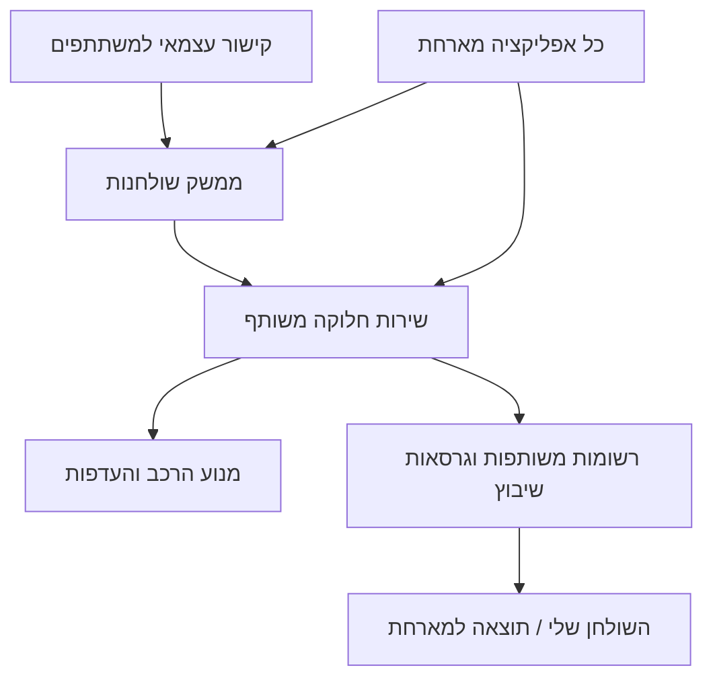

# שולחנות — תכנון מערכת חלוקה משותפת לכל האפליקציות

סטטוס: **טיוטה לאישור המשתמש**. המנוע (סעיף 8) כבר בנוי ונבדק ב-`packages/table-assignment`; כל השאר ממתין לאישור. תאריך: 2026-11-05. שם המושג שנבחר: **table-assignment** (טל, 2026-11-05).
מסמך משלים: [ארכיטקטורת המידע](../../ia/shared-table-assignment.md).

## 1. המטרה וההסכמות

מערכת שיוצרת שולחנות דיון לפי נושאים, עד שבעה אנשים בשולחן. כאשר המשתתפים מסרו עמדה, מטרת השיבוץ היא ליצור בכל שולחן ככל האפשר תמונת־מראה של כלל הנרשמים: ממוצע עמדות קרוב לממוצע הכללי ושונות גבוהה ודומה בין השולחנות. איכות ההרכב קודמת להעדפות הנושאים.

דרישות שאושרו בשיחה:
- נושאים עם הסבר, ובמידת הצורך מדדי C_p; הזנה ידנית או יבוא מהצעות שכבר נבחרו במערכת.
- מצב פשוט: המשתתף בוחר שולחן בעצמו.
- מצב מתוכנן: המשתתף מדרג שלושה נושאים, והמערכת משבצת.
- במצב המתוכנן, כשיש עמדות: הטרוגניות שווה ככל האפשר בין השולחנות לפני מימוש העדפות.
- לכל נרשם מקום אחד, ובכל שולחן לכל היותר שבעה אנשים.
- אותה מערכת פועלת עצמאית באמצעות קישור למילוי, או כשלב שאפליקציה אחרת מפעילה וחוזרת ממנו עם השיבוץ.
- תכנון תחילה, אישור המשתמש לפני מימוש.

כל החלטה נוספת במסמך היא **הצעה**, גם כשהיא מתוארת כברירת מחדל.

## 2. מוצר אחד, שני אופני הפעלה

**עצמאי:** המארגן יוצר פעילות ביישום חדש, „שולחנות” (`apps/tables`, בכתובת **tables.wizcol.com**; טל, 2026-11-05), מזין נושאים ובוחר מצב. הוא מקבל קישור משתתפים ו-QR להפצה. המשתתפים מצטרפים, ממלאים בחירות ועמדה אופציונלית, ורואים את שולחנם כשקיים שיבוץ תקף. אין צורך ליצור קודם סקר, מסמך או שיעור. המערכת מספקת קישור לשיתוף; שליחת הודעות בפועל אינה תנאי להפעלה.

**מתוך אפליקציה אחרת:** האפליקציה יוצרת פעילות דרך ממשק משותף, מעבירה הקשר, נושאים ורשימת משתתפים מורשית אם כבר קיימת, ופותחת את מסך החלוקה. מידע שכבר קיים אינו מתבקש שוב. אחרי הפרסום, המשתתף חוזר לפעילות המקורית והמארחת קוראת תוצאה עם מזהים יציבים. כשכבר יש את כל הקלט אפשר להפיק טיוטה ישירות דרך השירות, בלי מסך מילוי נוסף.

אלה שני אופני כניסה לאותו שירות ולרשומות משותפות. אין מנוע עצמאי שונה לכל אפליקציה. ממשק לקוח שאינו תלוי ב-React/Mithril/Svelte מאפשר גם מסך מקומי במארחת; בגרסה הראשונה מסך משותף נפתח בקישור וחוזר למארחת. הטמעת iframe אינה נדרשת.



## 3. מה כבר קיים ומה חסר

הבדיקה היא של קוד המקור המקומי, לא של פריסה פעילה.

| בסיס קיים | שימוש מוצע | הפער שיש להשלים |
|---|---|---|
| `packages/shared-types/src/models/rooms/roomsModel.ts` | תאימות למושגי חדר, הגדרות ומשתתף | אין נושאים מדורגים, גרסאות ריצה או כלל קשיח של שבעה |
| `functions/src/fn_roomAssignment.ts`, `functions/src/rooms/scrambleIntoRooms.ts` | ניסיון קיים בפיזור לפי קבוצות | `balanceScore` מחושב משונות גדלי החדרים; אינו מוכיח שונות עמדות או שוויון ביניהן |
| `functions/src/classroom/assignTables.ts` | דוגמה לשיבוץ מחנות ולמחולל אקראי מוזרק | מאפשר עד שמונה; חסרי צד מחולקים עם המרכז; אין העדפות נושאים |
| `functions/src/classroom/fn_classAssignTables.ts` | מתאם לשולחנות כיתתיים והרשאות מורה | שולחן מכיל גם מצב פעילות; אין להחליף אותו באופן עיוור |
| `functions/src/evaluation/chosenOptionsSelection.ts`, `updateChosenOptions.ts` | יבוא ההצעות הנבחרות לפי מנגנון הבחירה הקיים | צריך לשמר מקור וגרסה, בלי לחשב מחדש „מנצחים” לפי כלל אחר |
| `packages/event-core/src/deriveActivities.ts`, `activityUrls.ts` וה-registry ב-shared-types | הצגת פעילות והקישור אליה באפליקציות | יש להוסיף סוג פעילות ונתיבים לשולחנות; אין כיום תמיכה מלאה בכל יעדי האפליקציות |
| `packages/shared-types/src/models/agora/agoraParticipant.ts` | התאמת עמדת Agora, כשהיא רלוונטית לאותה שאלת צדדים | זהויות והקשר העמדה אינם גלובליים; חשבון אחד עשוי לייצג צוות במצב צוות |

אין להרחיב את האלגוריתם הישן תוך הנחה שמדד האיזון שלו מספיק. מוצע מנוע משותף חדש ומתאמי תאימות מפורשים, בלי לשנות חלוקות קיימות.

## 4. המושגים והמידע

| מושג | משמעות | מידע עיקרי מוצע |
|---|---|---|
| פעילות חלוקה — `TableAssignment` | בקשה אחת לחלוקת קהל, במסגרת אירוע או באופן עצמאי | בעלים, עוגן הרשאות, מצב, מדיניות, גרסת קלט, הפניה למארחת ולריצה שפורסמה |
| נושא — `TableAssignmentTopic` | על מה דנים; עשוי להיות משותף לכמה שולחנות | כותרת, הסבר, סדר, מקור אופציונלי, snapshot של המדד עם סוגו, סולמו וזמנו |
| שולחן — `TableAssignmentTable` | קבוצה פיזית בריצה מסוימת | מזהה, מספר/מיקום, נושא, קיבולת עד 7 |
| נרשם — `TableAssignmentParticipant` | אדם אחד בקהל הפעילות | מזהה מקומי יציב, קישורי זהות מאומתים, שם לתצוגה, סטטוס הרשמה |
| תשובת נרשם | הקלט הפרטי של המשתתף | עד שלוש העדפות מסודרות, עמדה אופציונלית ומקורה, זמן וגרסה |
| ריצת שיבוץ — `TableAssignmentRun` | תוצאת חישוב שאפשר לבדוק ולפרסם | snapshot קלט, גרסת אלגוריתם, seed, טיוטה/מוכן/כשל, מדדים, שיבוצים, מגבלות חיפוש |
| שיבוץ | שיוך אדם לשולחן בריצה | participantId, tableId, topicId, דירוג הבחירה שהתקבלה או „מחוץ לבחירות” |

קשר לעץ Statement: הפעילות מצביעה על `contextStatementId` מורשה ו-topParentId שנגזר ממנו. בהפעלה עצמאית השירות יוצר הקשר אירוע/קבוצה בלי לדרוש מהמשתמש לבנות עץ; בהפעלה משולבת הוא משתמש בהקשר הקיים. נושא ידני נשמר כ-TableAssignmentTopic, ללא יצירת הצעה מלאכותית; נושא מיובא מפנה ל-Statement המקורי ושומר snapshot מקומי לצורך עקביות, בלי להזיז או לשכפל את ההצעה כהצעה מתחרה. רשומות שולחנות, תשובות פרטיות וריצות נשמרות בנפרד מעץ התוכן. להצגה באג'נדת אירוע מרחיבים את event-core כך שיצרף פעילויות חלוקה לפי הקשר, לצד פעילויות הנגזרות מ-Statements. סוג הפעילות יוגדר במפורש ב-registry; אין להסוות אותה כשאלת הצבעה רגילה.

הטיפוסים והסכמות יהיו במקור המשותף `packages/shared-types`, וייצאו בחוזה המשותף שכל האפליקציות צורכות. הנחיות השורש מכנות אותו delib-npm; הקוד המקומי שנבדק משתמש ב-`@freedi/shared-types`. יש לשמר תאימות לנתיבי הצריכה בפועל, בלי ליצור טיפוסים מקבילים בתוך אפליקציות.

## 5. נושאים, מקומות ומספר שולחנות

- **נושא אינו שולחן.** מאפשרים כמה שולחנות לאותו נושא, ומדרגים נושאים במצב המתוכנן.
- הצעה: לכל נושא פעיל לפחות שולחן אחד. כמות השולחנות הנוספים לכל נושא יכולה להיקבע יחד עם השיבוץ כדי לשפר העדפות, אחרי השגת איכות ההרכב.
- עבור N נרשמים ו-K נושאים פעילים, מוצעת התחלה של `T = max(ceil(N/7), K)` שולחנות, עם גדלים הנבדלים לכל היותר באחד. המארגן יכול לבחור יותר שולחנות בגבולות המקום והאוכלוסייה.
- יש לבדוק מראש `T <= N` ושהמקום מכיל T שולחנות. אם אין די מקום לכולם, או שיש יותר נושאים מאנשים, נדרשת החלטת מארגן: אין „פתרון” באמצעות שולחן שמיני, השמטת נרשמים או סגירת נושא בשקט.
- דוגמה: 15 נרשמים ושלושה נושאים יתפצלו ל-5/5/5, ולא ל-7/7/1. שולחן יחיד אפשרי לקהל קטן; גודל מינימלי רצוי יוצג כהמלצה ולא כאילוץ שלא סוכם.
- מספר השולחנות ודרישות הכיסוי לנושאים נקבעים לפני השוואת חלוקות; האלגוריתם לא מוסיף שולחנות כדי לנפח מדד איכות.
- יבוא נושאים קורא את ההצעות שנבחרו במקור, כולל ההסברים והמדדים המותרים לפרסום. C_p מתאר את הנושא ואינו תחליף לעמדת האדם ואינו משקל קדימות בשיבוץ.
- בפתיחת ההרשמה ננעלת גרסת רשימת הנושאים. שינויים במקור אינם משנים בשקט את אפשרויות הבחירה; רענון יזום מחייב הסדרת העדפות שנפגעו לפני חישוב.

## 6. שלושה מצבי חלוקה

| מצב | מה המשתתף עושה | מה המערכת מבטיחה |
|---|---|---|
| בחירה ישירה | בוחר שולחן מסוים | מקום מאושר רק לאחר בדיקת קיבולת בשרת; אין הבטחת הטרוגניות |
| שיבוץ לפי העדפות | מדרג שלושה נושאים, או את כולם כשיש פחות משלושה | שיבוץ לכל הנרשמים במסגרת הקיבולת; העדפות לפני הגרלת שוויון |
| שיבוץ מגוון | מדרג נושאים ומוסר עמדה אופציונלית | הרכב מגוון ומאוזן קודם להעדפות; מוצגת איכות התוצאה שהושגה |

הגרלה כאן היא אקראיות מבוקרת לשבירת שוויון וליצירת מועמדים לחיפוש. **הגרלה טהורה שאינה מנסה לממש העדפות היא אפשרות מוצר נוספת, ולא ברירת המחדל המוצעת.**

בבחירה ישירה: הצטרפות/מעבר לשולחן נכתבים אטומית; אם היעד התמלא, השיבוץ הקודם נשמר. שולחן מלא מציע שולחנות אחרים. אין פתיחה אוטומטית של שולחן בלי מקום פיזי שהמארגן הגדיר. זה מצב חי, ולכן אישור מקום מוצג מיד; אין שלב טיוטת שיבוץ מרכזית לכל הצטרפות.

## 7. הגדרה מוצעת לאיכות ההרכב

### סולם עמדות מספרי

הפעילות מגדירה **שאלת צדדים אחת וסולם משותף**. ערכים כגון 0–100 מומרים לסולם קבוע, למשל ‎−1…+1, רק אם משמעות הקצוות תואמת. אין לערבב עמדות משאלות שונות. הגרסה הראשונה מטפלת בציר אחד; השוואה רב־ממדית דורשת הרחבה נפרדת.

עבור הנרשמים שמסרו עמדה: ממוצע כללי μ ושונות אוכלוסייה v. לכל שולחן t: מספר עמדות ידועות k_t, ממוצע μ_t ושונות אוכלוסייה v_t. המכנה הוא k_t, ולא אומד לשונות מדגמית. M הוא מספר העמדות הידועות בכל הפעילות.

```text
μ   = sum(x_i) / M
v   = sum((x_i - μ)^2) / M
μ_t = sum(x_i in table t) / k_t
v_t = sum((x_i - μ_t)^2 in table t) / k_t

B = sum((k_t / M) * (μ_t - μ)^2)
W = sum((k_t / M) * v_t)
v = W + B
```

לכן, עבור אותה אוכלוסייה בעלת עמדות ידועות, הקטנת הפערים בין ממוצעי השולחנות מגדילה את השונות הממוצעת בתוך השולחנות. אבל היא **אינה מבטיחה ששונות זו מתחלקת שווה**, ולכן צריך גם מדד נפרד לשוויון השונויות.

**ההחלטה (טל, 2026-11-05): סובלנות מובנית, לא סדר קפדני.** לכל שולחן מחשבים סטייה מהקהל: |μ_t − μ| / σ + |σ_t − σ| / σ (σ שורש v; הפיזור נספר רק כשיש בשולחן לפחות שתי עמדות ידועות; ממוצע על פני צירים כשיש כמה). הסדר בין חלוקות:
1. **אילוץ קשיח**: הסטייה של השולחן הגרוע ביותר אינה עולה על סובלנות מפורשת (ברירת מחדל 0.3, בידי המארח; מוצגת יחד עם התוצאה). כשאין חלוקה שעומדת בה, מציגים את הטובה ביותר שנמצאה ומסמנים חריגה.
2. בתוך האילוץ: למקסם את ציון ההעדפות (ראשונה 3, שנייה 2, שלישית 1, מחוץ לבחירות 0).
3. בשוויון בהעדפות: למזער את הסטייה המקסימלית, ואז את סכום הסטיות (שולחנות דומים זה לזה).
4. להגריל בין פתרונות שווים, באמצעות seed שמור.

הסיבה: סדר קפדני מתעקש על הבדלים חסרי משמעות באיזון (4-3 מול 3-4 בשולחן של שבעה) לפני שהוא מסתכל על מה שאנשים ביקשו. הסובלנות היא מדיניות גלויה, לא מספר נסתר: מדידה על קהל מקוטב של 100 שבו העמדה מנבאת את הנושא הראתה שסובלנות 0.3 מורידה את השיבוצים מחוץ לבחירות מ-46% (כמעט קפדני) ל-36%, כשהסטייה בפועל נשארת סביב 0.2. כשההעדפות אינן תלויות בעמדה, הסובלנות כמעט אינה משנה (80–89% בחירה ראשונה בכל ערך). זה בדיוק מה שמומש ב-`packages/table-assignment`.

### צדדים שהם קטגוריות

כשצדדים הם שמות ללא סדר או מרחק מספרי, אין משמעות לממוצע של קודים 1/2/3. כל צד מיוצג בשיעורו באוכלוסייה (`p_c`) ובשולחן (`p_tc`). מודדים מרחק מההתפלגות הכללית `d_t = 0.5 * sum_c(abs(p_tc-p_c))`, ומגוון פנימי `h_t = 1 - sum_c(p_tc^2)`.

ההשוואה המוצעת: למזער תחילה את המרחק הגרוע ביותר, לאחריו את המרחק הממוצע המשוקלל, ולאחריו את פער המגוון בין השולחנות; העדפות ואקראיות באות אחר כך. היעד הוא מגוון שיש בקהל, לא ייצוג 50/50 כשהקהל 80/20. אין להמציא מרחק בין צדדים על סמך שמותיהם.

### עמדות חסרות ומקרים בלתי מושלמים

- „לא מסרתי עמדה” הוא מצב חסר, לא מרכז ולא צד נוסף שמגדיל מלאכותית את המגוון.
- מחלקים מראש את מספרי העמדות הידועות ביחס לגודל השולחנות, עד כדי עיגול למספרים שלמים; מכסות אלו קבועות בהשוואת החלוקות, כדי שלא יהיה כדאי להחביא אנשים בשולחן שאי אפשר למדוד.
- שולחן בלי עמדות ידועות מסומן „אין מידע”, ובו אין μ_t או v_t. עם עמדה ידועה אחת השונות המחושבת אפס, אך אין מספיק מידע להעריך גיוון. מציגים תמיד כיסוי `k_t / n_t`.
- אם אין עמדות כלל, פועלים לפי העדפות ואקראיות; לא מציגים הבטחת גיוון. אם יש עמדה אחת או כולן זהות, אין מגוון ידוע שאפשר ליצור; הדבר גלוי בדוח.
- אם כל הנרשמים בחרו אותו נושא, ההטרוגניות עדיין קובעת את הרכב הקבוצות, אבל חובת כיסוי נושאים אחרים עלולה ליצור שיבוצים מחוץ לבחירות. מציגים את המחיר מראש.
- מיעוט קטן ממספר השולחנות, גדלים שונים או כמות קטנה של משתתפים עלולים למנוע שוויון מדויק. הדוח מציג את הפערים בפועל, בלי לטעון שהושג שוויון מושלם.

## 8. מנוע השיבוץ ואמינות התוצאה

מנוע טהור ומנותק מממשק/Firestore ב-`packages/table-assignment` (`@freedi/table-assignment`) — **קיים ונבדק**, 36 בדיקות יחידה וסקריפט סימולציה (`npm run simulate`). גישה לנתונים, הרשאות והפעלת ריצות ב-`functions/src/tableAssignment` ולקוח משותף ב-`packages/table-assignment-client` הם שמות מוצעים, עדיין לא קוד.

מה המנוע עושה בפועל (`assignTables(participants, topics, options)`):
1. מספר השולחנות לכל נושא לפי ביקוש בחירה ראשונה (חלוקת Hamilton), בחירות 2 ו-3 שוברות שוויון בלבד, תקרת `maxTables` לנושא; גדלים מתפזרים שווה (22 נרשמים → 6,6,5,5).
2. חלוקה ראשונית בנחש לאורך ציר העמדה, כך שכל שולחן מקבל פרוסה מכל חלק של הספקטרום.
3. חיפוש החלפות זוגות: החלפה מתקבלת אם היא משפרת העדפות והשולחן הגרוע ביותר נשאר בתוך הסובלנות, או אם היא לא פוגעת בהעדפות ומהדקת את האיזון. ארבע התחלות עם seed, הטובה נבחרת.
4. מדד הרכב לשולחן: |הסטת ממוצע| + |הסטת פיזור| ביחידות סטיית תקן של כלל הנרשמים, ממוצע על פני צירים; 0 הוא מראה מושלמת. ברירת מחדל לסובלנות: 0.3.
5. מושבים נעולים (`locked`) להרצה חוזרת בלי לטלטל את החדר; עמדה רב-צירית; נרשמים ללא עמדה לא נספרים באיזון.

מדידה (seed 42, 6 נושאים, שולחן 7, סובלנות 0.3): 19 תרחישים (30/100/300 נרשמים × מקוטב/מרוכז/אחיד × העדפות תלויות/בלתי תלויות בעמדה), כולם בתוך הסובלנות. כשההעדפות בלתי תלויות בעמדה 83–92% מקבלים בחירה ראשונה; כשהעמדה מנבאת את הנושא ~66–76% בחירה ראשונה ו-~30% בחירה שלישית, מחיר מובנה של "שולחן כמראה". 300 נרשמים: 0.5–1.8 שניות.

החיפוש משלב יצירת חלוקות התחלתיות מפוזרות, מספר התחלות עם seed, החלפות זוגות/מחזורים ושינוי שיוך נושאים לשולחנות. בכל מועמד בודקים את האילוצים ואת סדר המדדים לעיל. שיפור העדפות מחפש גם בין הרכבים שונים בעלי אותה איכות; לא מקבעים חלוקה אקראית ראשונה ואז מסתפקים במתן שמות לשולחנות.

זו **שיטת חיפוש משוערת**, שאינה מבטיחה אופטימום עולמי. בריצה נשמרים תקציב החיפוש, גרסה, seed, כמות מועמדים והמדדים שהושגו. לשחזור משתמשים בסדר קלט קנוני ובתקציב איטרציות דטרמיניסטי; עצירת זמן חריגה מתועדת. במקרים קטנים בודקים מול מונה פתרונות מלא. אם יידרש אופטימום מוכח לאירועים גדולים, בחירת solver מדויק היא שלב נפרד המבוסס על תוצאות מדידה.

תוכנית בדיקת ביצועים מוצעת: 30, 100, 500 ו-1,000 נרשמים, עם כמה התפלגויות והיקפי נושאים. זמני תגובה וגודל אירוע נתמך ייקבעו לפי מדידה לפני השקה, לא כהבטחה בתכנון. ריצה ארוכה מתבצעת כעבודה ברקע עם סטטוס ולא מחזיקה מסך או בקשת HTTP פתוחה.

## 9. מחזור חיים ותוצאה יציבה

מצבי פעילות: `draft → open → locked → published → closed`; הטיוטות והעבודות החישוביות מנוהלות בנפרד ב-TableAssignmentRun. במצב ישיר מצב open כולל כבר אישורי מקום חיים; סגירת ההרשמה מקבעת את התוצאה.

- נעילת הרשמה מצלמת קלט בעל גרסה: נרשמים פעילים, העדפות, עמדות, נושאים, מספר שולחנות ומדיניות. ביטול הרשמה לפני הנעילה מסיר אדם מאוכלוסיית השיבוץ.
- נרשם שלא השלים העדפות אינו נעלם מהחלוקה. המארגן רואה שחסר דירוג; אם ההרשמה ננעלת כך, האדם משובץ לפי ההרכב והמקומות ללא העדפת נושא. הוא נספר בנפרד בדוח ולא כמי שקיבל בחירה ראשונה או כנכשל במימוש בחירות שלא מסר.
- שינוי קלט פוסל טיוטה קודמת לפרסום. המארגן רואה שהטיוטה התיישנה ומחשב מחדש.
- בתצוגה המקדימה מופיעים גדלים, איכות ההרכב, שיעור העמדות הידועות ומספר מקבלי בחירה ראשונה/שנייה/שלישית/אחרת. המארגן יכול לבדוק תוצאה לפני פרסום.
- פרסום מקבע `publishedRunId` רק אחרי שכל מסמכי הריצה נכתבו ונבדקו, בהשוואת גרסת קלט ובפעולה אטומית קטנה. ריצה גדולה אינה נשענת על טרנזקציה שמכילה את כל המשתתפים; לקוחות אינם רואים ריצה שנכתבה חלקית.
- פרסום חוזר של אותה בקשה הוא idempotent. אין ערבוב תוצאות בין שתי ריצות שהתחרו, ואין מעבר אוטומטי לריצה חדשה בגלל שינוי במקור.
- לאחר פרסום, מאחרים וביטולים אינם מערבבים את כולם מחדש. הצעה: המארגן מציע תיקון/שיבוץ למקום פנוי בגרסה חדשה, רואה את ההשפעה ומפרסם; המשתתפים המושפעים רואים שינוי ברור.
- תיקון ידני אינו עוקף קיבולת, כפילות או הרשאות. הוא מסומן כחריגה מפתרון המנוע ונמדד מחדש; אין להציגו כאופטימום.

## 10. חוזה משותף לכל האפליקציות

פעולות מוצעות: `createSession`, `importTopics`, `registerParticipant`, `savePreferences`, `joinTable`, `leaveTable`, `lockInputs`, `createRun`, `getRun`, `publishRun`, `getMyAssignment`, `getPublishedAssignments`, `closeSession`. פעולות שמשנות מצב מקבלות גרסה צפויה ומפתח idempotency היכן שנדרש.

**בקשת הפעלה:** sourceApp, sourceContextId, עוגן הרשאות, mode, נושאים/מקורות, מדיניות עמדות וקיבולת, הפניות משתתפים מאומתות ויעד חזרה רשום. האפליקציה יכולה למסור קלט קיים או לבקש השלמתו בממשק המשותף. אימות השרת קובע מי רשאי לייבא ומי נכלל; adminId שהלקוח שולח אינו הרשאה.

**תוצאה:** sessionId, publishedRunId, revision, status, tables, ושיבוצים לפי participantId/מזהה המארחת המורשה. עמדות גולמיות אינן חלק מתוצאת המשתתף. המארחת מאזינה לגרסה שפורסמה או קוראת אותה; הודעת „הושלם” היא רמז לקריאה חוזרת מהשרת, לא מקור האמת.

פעילות קצרה מתוך אפליקציה אינה בהכרח חלוקה מיידית: לאחר מסירת העדפות אפשר לחזור למארחת במצב pending, ולהציג בה את השולחן לאחר פרסום. במצב הישיר חוזר אישור המקום שכבר נשמר. מסלול קריאת התוצאה מבדיל במפורש בין pending, מקום ישיר מאושר, ריצה שפורסמה וכשל.

**זהות:** מזהה משתתף בפעילות מייצג אדם, ולא בהכרח חשבון. כניסה עצמאית קלה משתמשת בהזדהות אורח והמשך באותו דפדפן; היא אינה מוכיחה שאדם לא נרשם שוב במכשיר אחר. באירוע שדורש רשימה סגורה משתמשים בהזמנות אישיות/רשימת משתתפים. מעבר בין דומיינים נעשה בחילוף זהות קצר־חיים מאומת בשרת, לא בהנחת שיתוף localStorage ולא באמצעות UID או token קבוע בכתובת. מתאם כיתתי חייב לתמוך גם באנשים ללא מכשיר; חשבון צוות אינו „אדם אחד” לצורך קיבולת.

יעדי החזרה נגזרים מרישום האפליקציות והקשר שמותר למשתמש לקרוא; אין לקבל URL שרירותי. ביטול התהליך מחזיר למארחת מצב canceled/incomplete ללא תוצאה חדשה, ומשאיר תוצאה קודמת תקפה אם ישנה.

| אפליקציה | חיבור מוצע |
|---|---|
| שולחנות העצמאית | יצירה, קישור/QR, איסוף מידע, שיבוץ ופרסום |
| Main ו-Studio | יצירה וניהול מתוך אירוע, יבוא הצעות נבחרות והצגת מצב הפעילות |
| MC | מעבר מסקר/תוצאות נבחרות לחלוקה; חיבור זהויות משתתפים אנונימיים לפי ההקשר |
| Sign | הפעלת דיון שולחנות על מסמך/הצעות מורשות וחזרה למסמך |
| Join | שלב משתתף קצר: בחירות, המתנה ושולחן אישי |
| Join-class ו-Agora | יבוא רשימה ועמדות רלוונטיות, והחזרת שיבוץ למתאם השולחנות המקומי; שימור זהויות ומצב השיעור |
| Flow ו-Chat | שלב חלוקה בתוך התהליך וחזרה לאותו הקשר דיון |
| Odyssey | הפעלה בהקשר הפעילות והחזרת קבוצות; בלי להסיק עמדה מהדמות במשחק |
| Admin | מצב ותפעול מורשים לקריאה; אין צורך להפוך אותו לאפליקציית הרשמה |

כל האפליקציות יכולות להשתמש בחוזה ובקישור המשותפים מהגרסה הראשונה של השירות. השלמת מתאמים ואימות מסלול בכל אפליקציה הם חלק מתוכנית המימוש; אין להכריז „משולב בכל האפליקציות” רק משום שנוצר endpoint.

## 11. גבולות גישה ואחסון

החלטה 2026-11-05: ההעדפות והעמדה נשמרות ברשומת הנרשם (`tableAssignmentParticipants`), ללא אוסף תשובות נפרד. הכללים מאפשרים קריאה רק לנרשם עצמו (uid שלו) ולמארח החלוקה; הממשק אינו מציג לעולם עמדה או העדפות של אדם מסוים, אלא ספירות בלבד; ריצות חושפות רק חברות בשולחן ומדדים מצטברים. כל אזכור בהמשך לאוסף תשובות נפרד מוחלף בהחלטה זו.

אוספים מוצעים: `tableAssignments`, `tableAssignmentTopics`, `tableAssignmentParticipants`, `tableAssignmentRuns`, ו-tables/assignments תחת גרסת הריצה. במצב ישיר יש רישום מקומות חי ייעודי, עם בדיקת קיבולת בשרת. מנגנון הקריאה המשותף מחזיר מצב ישיר או ריצה שפורסמה בהתאם למצב הפעילות.

תשובות פרטיות נשמרות בנפרד מנתוני תצוגת שולחן. משתתף קורא/עורך רק את תשובתו לפני נעילה וקורא את השיבוץ המותר לו; מארגן מורשה קורא נתוני תפעול בהקשר הפעילות. עמדה אינה מתפרסמת ברשימת היושבים, בקישור או ב-QR. מי שנכנס מהקישור אינו מקבל בכך זכויות ניהול. נתוני הסבר ומדדים המיובאים ממקור פרטי נבדקים מול קהל היעד; אין להרחיב את חשיפתם אוטומטית.

אינדקסים מתוכננים לפי קריאות בפועל: פעילויות לפי עוגן/בעלים/מצב, נרשמים לפי sessionId, ריצות לפי sessionId, ושיבוץ אישי לפי participantId וגרסה. כל ריצה כוללת חותמות זמן במילישניות וסכמות ולידציה משותפות. מדיניות מחיקה/שמירה יורשת את ההקשר המארח או מוגדרת לפעילות העצמאית; מחיקה כוללת גם snapshots פרטיים בריצות.

## 12. תוכנית מימוש לאחר אישור

1. **חוזה ומדיניות:** סגירת ההחלטות בסעיף 14, טיפוסים וסכמות משותפים, ממשק מתאמים וגרסאות; אישור IA לפני עיצוב מסכים.
2. **מנוע מדיד:** אילוצים, מצב מספרי וקטגוריאלי, העדפות, seed ודוח איכות; השוואה לפתרון מדויק במקרים קטנים.
3. **שירות משותף:** הרשאות, הרשמה, בחירה ישירה אטומית, נעילה, עבודות רקע, preview ופרסום בעל גרסה.
4. **אפליקציה עצמאית וחיבור מארח ראשון:** קישור/QR, מילוי בטלפון, מסך מארגן ושולחן אישי; בדיקת יציאה מ-Join או Studio וחזרה עם אותה זהות ותוצאה.
5. **כלל האפליקציות:** מתאמי המקור/זהות/תוצאה בטבלה לעיל, רישום נתיבים, בדיקת חוזה ומסלול משתמש בכל אפליקציה. UI מקומי נוסף רק כשיש לו צורך, בלי לשכפל מנוע.
6. **תאימות והשקה:** מעבר אופציונלי לפעילויות חדשות מהמנגנונים הישנים. פעילויות ישנות נשארות במסלול שלהן; adapter לא דורס שולחן כיתתי שכבר התחיל דיון. פריסה מדורגת ומדידת איכות וביצועים.

הגרסה הראשונה כוללת סבב חלוקה אחד, עמדה על ציר אחד או קטגוריית צד אחת, והעדפות לשלושה נושאים. מניעת מפגש חוזר בסבבים, אופטימיזציה רב־ממדית ואילוצי „חייב/אסור לשבת יחד” הם הרחבות עתידיות; אין להחביאם בתוך הבטחת ההשקה.

## 13. קריטריונים לקבלה

- כל נרשם פעיל מופיע בדיוק פעם אחת, אפס שולחנות מעל שבעה, וכל שיוך מצביע על נושא ושולחן תקפים.
- אותו snapshot, seed, גרסת מנוע ותקציב איטרציות מחזירים אותה תוצאה.
- דוגמת נגד: שולחן עם קיצוניים משני הצדדים ושולחן של אנשי מרכז אינם נחשבים מאוזנים רק משום שממוצעיהם שווים; נבדקת גם שונות.
- מקרי קצה: 0/1 נרשמים, 8/15 נרשמים, פחות משלושה נושאים, מיעוט זעיר, כולם מאותו צד, חוסר עמדות מלא/חלקי, כפילויות זהות, יותר נושאים ממקומות וכולם מעדיפים אותו נושא.
- אימות המשוואה v=W+B ושימוש עקבי באוכלוסיית העמדות הידועות; בדיקת מדדים קטגוריאליים בלי קידוד מספרי שרירותי.
- העדפות אינן עוקפות איכות הרכב: בדיקת פתרונות שבהם העדפות טובות יותר מתנגשות במדד קודם. במקרים קטנים משווים את כל וקטור המטרות לאופטימום מחושב.
- מדווחים בכנות פער מהאופטימום כשהוא ידוע; בחיפוש משוער לא מדווחים „מיטבי” בלי הוכחה.
- שתי הצטרפויות למקום השביעי אינן יוצרות מקום שמיני; ניסיון מעבר שנכשל אינו מוחק מקום קיים.
- בקשות כפולות, ריצות מתחרות, שינוי העדפה בזמן חישוב, כשל באמצע כתיבה ופרסום טיוטה ישנה אינם משחיתים תוצאה פעילה.
- מסלול עצמאי מלא ומסלול מארח מלא, כולל חזרה, ביטול, אורח וזהות כיתתית; בדיקות הרשאות חוצות אפליקציות ומניעת קריאת תשובות של אחרים.
- נגישות, RTL ותרגומים בשפות הנתמכות; הממשק מציג הצלחת שמירה רק אחרי אישור השרת, ותוצאות נגישות גם בחזרה מאוחרת לקישור.

## 14. ההחלטות המוצעות לאישור

| החלטה | ברירת מחדל מוצעת | משמעות |
|---|---|---|
| מוצר וכניסה | אפליקציית שולחנות עצמאית + שירות/ממשק משותפים לכל המארחות | אותו קישור ואותה תוצאה גם כשהחלוקה היא רק שלב בתהליך |
| נושאים מול שולחנות | כמה שולחנות לנושא; לפחות אחד לכל נושא פעיל | נושא מבוקש יכול לקבל יותר מקבוצה אחת; מקום פיזי מגביל |
| איכות הרכב | סדר המדדים בסעיף 7, לפני העדפות | ממוצע קרוב, שונות גבוהה ודומה; השוואה מפורשת של פשרות |
| מחוץ לשלוש בחירות | מותר כשנדרש להשגת ההרכב המועדף או לשיבוץ כולם | מוצג למשתתף מראש ומודגש למארגן לפני פרסום |
| אין עמדות | שיפור העדפות והגרלה בשוויון | אין הבטחת הטרוגניות בלי מידע ואין הסקת עמדות |
| זהות עצמאית | אורח קל כברירת מחדל; רשימת הזמנות לאירוע סגור | איזון בין קלות מילוי לבין מניעת הרשמות כפולות |

לא נבחרת כאן אוטומטית חלופה של „רק שלוש הבחירות מותרות”: אם תועדף, היא תהיה אילוץ קשיח שעלול להשאיר בעיה בלתי פתירה, ויידרש מסלול פתרון גלוי במקום להבטיח שיבוץ לכולם.
